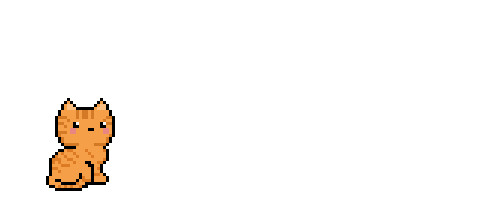
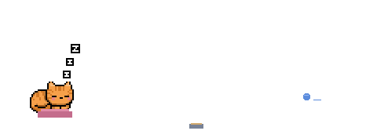

# catfolio

Un gatito pixel-art para el README de tu perfil. Se mueve por una escena en loop
y cambia de ánimo según tus commits de los últimos 7 días. Inspirado en
[git-koi](https://docs.rs/crate/git-koi/latest).

<p align="center">
  
</p>

## Estados

La escena está vacía: solo el gato. Duerme si no hiciste commits y, si hiciste,
camina por todo el espacio (horizontal y vertical) y se sienta de vez en cuando.
Cuanto más commits, más grande.

| Estado | Commits (7 días) | Qué hace |
|---|---|---|
| `sleep` | 0 | Duerme enroscado. |
| `small` | 1 a 3 | Gatito chico paseando. |
| `medium` | 4 a 9 | Más grande. |
| `large` | 10 o más | El más grande. |

<p align="center">
  
  
  
  
</p>

## Pelajes

`gris`, `naranja`, `calico`, `siames`, `blanco`, `esmoquin`, `negro`, `atigrado`.
Cada uno está en `dist/<pelaje>/<estado>.gif`.

## Uso en tu perfil

1. Copiá [`examples/workflow.yml`](examples/workflow.yml) a
   `.github/workflows/cat.yml` de tu repo de perfil (`TU_USUARIO/TU_USUARIO`) y
   cambiá `Marescaa` por el usuario donde tengas este repo.
2. Pegá en tu `README.md`:

   ```html
   <p align="center"></p>
   ```

3. Corré el workflow una vez a mano (`Actions → gato → Run workflow`). Después se
   actualiza solo todas las noches.

### Opciones del Action

| Input | Por defecto | Descripción |
|---|---|---|
| `coat` | `naranja` | Pelaje. |
| `state` | `auto` | `auto` según commits, o forzar `sleep`, `small`, `medium`, `large`. |
| `days` | `7` | Ventana de días. |
| `login` | dueño del repo | Cuenta a consultar. |
| `output-dir` | `cat` | Carpeta de salida (`cat.gif`, `cat.json`, `preview.html`). |

## Línea de comandos

```bash
python src/git_cat.py --login TU_USUARIO --coat gris --output-dir cat   # usa GITHUB_TOKEN
python src/git_cat.py --commits 5 --coat negro --output-dir cat         # sin red
python src/git_cat.py --state sleep --coat calico --output-dir cat
```

Solo usa la biblioteca estándar de Python.

## Estructura

```text
.
├── action.yml      el GitHub Action
├── assets/gatos/   sprites originales (sentado, lamiendose, dormido, caminando)
├── dist/           escenas ya renderizadas, 8 pelajes x 4 estados
├── examples/       workflow de ejemplo
├── src/            git_cat.py: elige el estado y copia el GIF
├── tests/          umbrales y existencia de los GIF
└── tools/render.py regenera dist/ desde assets/ (requiere Pillow)
```

Para regenerar las escenas: `pip install -r requirements-dev.txt && python tools/render.py`.

## Licencia

MIT. Ver [LICENSE](LICENSE).
