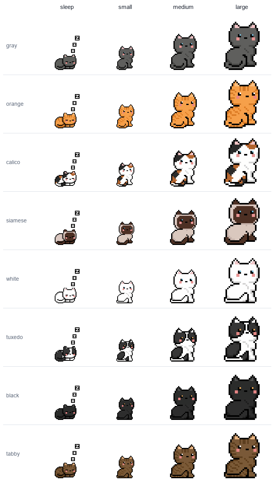
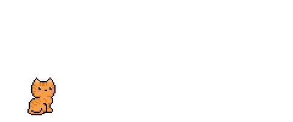
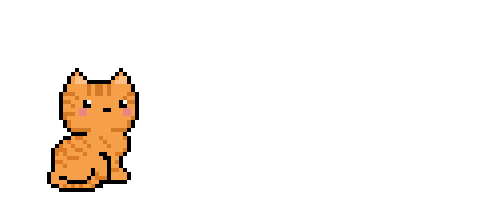

# Catfolio

Catfolio draws a pixel-art cat from a GitHub account's public activity. Its
coat is your choice, its commits grow it, and a quiet week puts it to sleep. A
nightly workflow puts the cat on a profile README as a looping GIF, the same
tool runs from the command line, and everything it needs ships in the repo.

<p align="center">
  
</p>

<picture>
  <source media="(prefers-color-scheme: dark)" srcset="docs/coats-dark.png" />
  
</picture>

## Repository Structure

```text
.
├── assets/       the original sprites: sitting, walking, sleeping, licking
├── dist/         the rendered scenes, 8 coats x 4 states
├── docs/         the getting-started guide and the coat sheets
├── examples/     the profile workflow
├── src/          the git_cat.py command that picks the state and copies the GIF
├── tests/        the state thresholds and the shipped GIFs
├── tools/        render.py rebuilds dist/, sheet.py rebuilds the coat sheets
└── action.yml    the GitHub Action
```

## Usage

### States

The scene is empty: just the cat, wandering the whole space, horizontally and
vertically, and sitting down now and then. The loop never cuts.

| State | Commits (last 7 days) | What it does |
|---|---|---|
| `sleep` | 0 | Sleeps curled up. |
| `small` | 1 to 3 | A small cat on a stroll. |
| `medium` | 4 to 9 | Bigger. |
| `large` | 10 or more | The biggest. |

<p align="center">
  
  
  
  
</p>

### Coats

`gray`, `orange`, `calico`, `siamese`, `white`, `tuxedo`, `black`, and `tabby`.
Each one is in `dist/<coat>/<state>.gif`.

### Requirements

- For a cat on your profile README: a GitHub account. The Action runs in your
  profile repository's workflow with its built-in token.
- For the command line: Python 3.8 or newer. Nothing else.
- To rebuild the scenes: Python and [Pillow](https://python-pillow.org).

[docs/getting-started.md](docs/getting-started.md) walks through the Action in
a profile workflow, the command line, and rebuilding the scenes.

### Action inputs

| Input | Default | Description |
|---|---|---|
| `coat` | `orange` | The coat. |
| `state` | `auto` | `auto` picks it from your commits, or force `sleep`, `small`, `medium`, or `large`. |
| `days` | `7` | How many days of commits to count. |
| `login` | repository owner | The account to read. |
| `output-dir` | `cat` | The folder that receives `cat.gif`, `cat.json`, and `preview.html`. |

## Author

**Francisco Maresca**

- Email: marescafran0@gmail.com
- GitHub: [@Marescaa](https://github.com/Marescaa)

## Acknowledgements

Inspired by [git-koi](https://docs.rs/crate/git-koi/latest) by Anthony Yalong.

## License

MIT. See [LICENSE](LICENSE).
